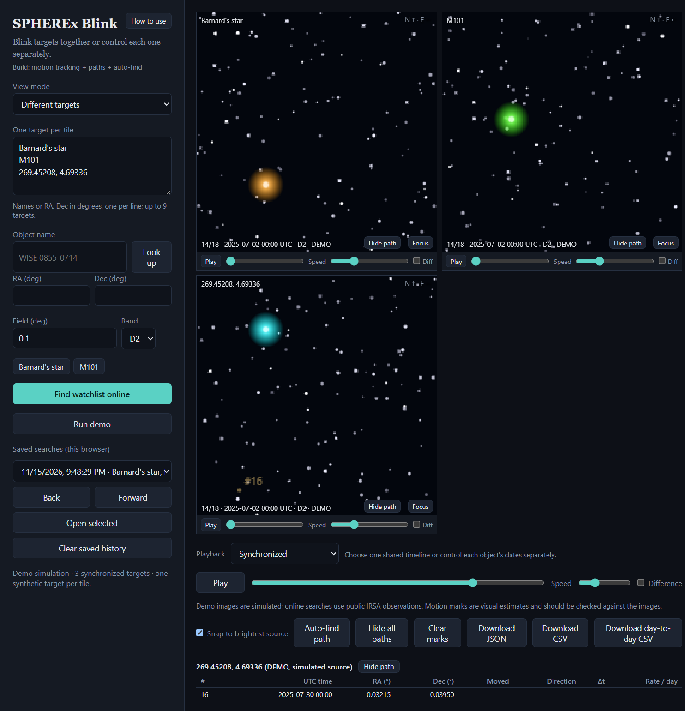
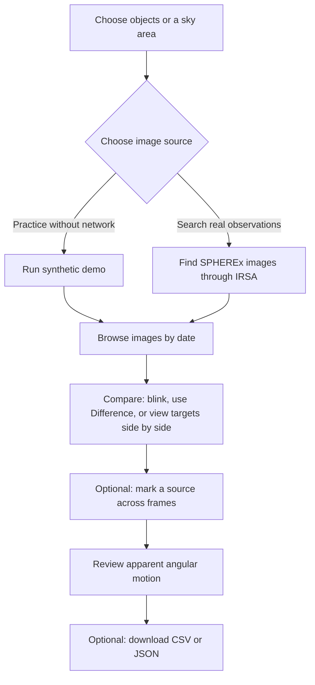
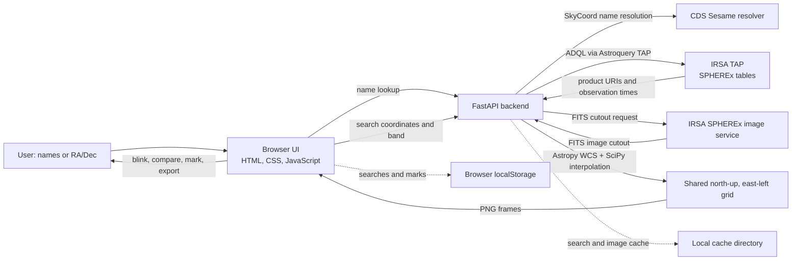

# SPHEREx Blink

Compare public SPHEREx observations of multiple targets side by side to inspect changes and possible motion over time.

## Project and challenge
- **Project:** SPHEREx Blink
- **Selected challenge:** Planet X and SPHEREx
- **Live prototype:** [Open SPHEREx Blink](https://spherex-blink-fqyx.onrender.com/)
- **Presentation:** [View the SPHEREx Blink project introduction (PDF)](https://github.com/I5Ha-dotcom/Blinking-and-moving-objects/blob/main/presentation%20%28pdf%29/SPHEREx-Blink-Project-Introduction.pdf)
- **Development story:** [Read the project history and development log](docs/PROJECT_HISTORY.md)

> **Status note (Nov 15, 2026, 11:47 PM ICT, UTC+7):** In the latest documented integration attempt, IRSA's SPHEREx TAP request returned a proxy error, so a successful live search has not been verified. Online searches depend on IRSA. The offline demo uses synthetic data and works without IRSA. No real-data results are presented in this README.

## Problem and proposed solution
Finding a moving or changing source in a large collection of astronomical images can require manually opening and comparing observations from different dates. This makes it difficult to notice motion, especially when observations are separated in time or the object is faint.

SPHEREx Blink brings observations for selected sky positions into one browser view. It aligns image cutouts to a common sky orientation and lets users blink through them in time order, compare different targets together, and mark candidate positions for follow-up. An offline simulation makes the interface usable for demonstrations when IRSA is unavailable; it does not represent real astronomical observations.

### See the prototype
The screenshot shows three separate target panels, each with its own image and controls. It is the **synthetic demo**, not real SPHEREx data. The [demo recording](docs/media/spherex-blink-demo.mp4) walks through the application.

### The workflow at a glance
Choose what to look at, load either the offline demo or public observations, compare images over time, and optionally mark and export a candidate's apparent motion.

In short: pick targets → load images → compare dates → optionally mark a source → review or export. Demo images are simulated; measurements describe apparent motion on the sky, not physical distance through space.

## How it works
Enter object names or `RA, Dec` coordinates. Names are resolved to sky coordinates, and the online search asks IRSA for SPHEREx observations covering each position. The app retrieves image cutouts, reprojects them to a common tangent-plane grid (north up, east left), and displays the resulting frames. Users can inspect the images by blinking, stepping, and scrubbing, then mark a source across frames and export the measurements.

The browser UI is served by a FastAPI backend. The backend uses IRSA's TAP service to find observations and its cutout service to fetch FITS images; Astropy WCS and SciPy interpolation align the cutouts, and the backend returns PNG frames. Search results and generated cutouts are cached on the server. Search history and motion marks are stored separately in the browser's local storage.

### Technical architecture

### Technologies, languages, and tools
- **Languages and browser APIs:** Python 3.12, HTML, CSS, JavaScript, browser Canvas, `localStorage`, and the History API.
- **Backend and server:** FastAPI and Uvicorn.
- **Astronomy and data processing:** Astropy (coordinates, FITS, time, and WCS), Astroquery (IRSA TAP), NumPy, and SciPy (`ndimage.map_coordinates`).
- **Image and HTTP handling:** Pillow and Requests.
- **Development environment:** Visual Studio Code, Windows PowerShell, Git, and the Python dependencies declared in [`requirements.txt`](requirements.txt).

## NASA datasets and APIs
The online search uses NASA/IPAC Infrared Science Archive (IRSA) SPHEREx services. The backend queries the public `spherex.artifact` and `spherex.plane` TAP tables for product URIs, observation times, and bands; it then requests FITS cutouts from the returned IRSA product URLs. The query follows the archive's currently available table contents rather than selecting a release with a separate release filter. Current archive documentation describes SPHEREx DR1 and QR3 products.

- **Dataset:** SPHEREx public spectral images and release information in IRSA ([mission and release index][ref-spherex-irsa], [DR1 overview][ref-dr1], [Quick Release overview including QR3][ref-qr]).
- **Metadata API:** IRSA Table Access Protocol (TAP), accessed through Astroquery's `query_tap` and asynchronous TAP client ([Astroquery IRSA query documentation][ref-astroquery-irsa], [configured TAP endpoint][ref-tap]).
- **Image access:** FITS spectral-image cutouts from the IRSA product URIs returned by TAP ([SPHEREx archive user guide][ref-spherex-guide]).
- **Name resolution:** Astropy's `SkyCoord.from_name` uses an external astronomical name resolver; this is a coordinate-resolution service, not a NASA dataset API ([CDS Sesame][ref-sesame]).

## Main features
- Compare up to 9 different targets, one per panel, with synchronized playback; alternatively use adjacent sky tiles or a single field.
- Choose synchronized playback with one shared timeline, or independent playback with per-target play/pause, frame scrubber, speed, and Difference controls.
- Search by resolvable object name or explicit sky coordinates.
- Browse observations by date and detector band, focus a panel, or return to the grid.
- View signed differences from the per-band median: warm colors indicate brighter residuals, cyan indicates dimmer residuals, and black indicates no change. This is a visual aid, not calibrated photometry.
- Run a local moving-source demo without contacting IRSA.
- Mark source positions across frames, remove marks, inspect or auto-find candidate paths, and export JSON or CSV measurements.
- Save up to 30 searches in the current browser profile and restore them with the saved-search selector or Back/Forward navigation.
- Use the detailed first-visit walkthrough, or reopen it at any time with **How to use**. It covers the page controls and skips steps that do not apply to the selected view or playback mode.

## How to use

### 1. Start the app
Follow the [Run](#run) instructions, then open `http://127.0.0.1:8000` in your browser. On the first visit in a browser profile, a detailed guide of up to 31 steps appears (steps for other view modes or playback modes are skipped). Select **Next** to follow its highlighted controls, **Back** to revisit a step, or **Close** or press **Escape** to exit. You can reopen it at any time with **How to use**. The tour setting is saved in this browser; clearing this site's local storage makes it appear again.

### 2. Choose a view and enter targets
- **Different targets:** compare different objects, one per panel. Enter one object name or an `RA, Dec` pair in degrees per line in **One target per tile**. Up to 9 targets are supported. Names must be resolvable by the name service.
- **Adjacent sky tiles:** enter the center position using **Object name** and **Look up**, or fill in **RA (deg)** and **Dec (deg)**. Choose a 2 × 2 or 3 × 3 tile layout. The tiles cover neighboring patches of sky, with north up and east left.
- **Single field:** use the name lookup or enter the RA/Dec coordinates of one sky position.

Set **Field (deg)** and the detector **Band** as needed. The example buttons can fill in sample object names.

### 3. Load images: demo or online
- Select **Run demo** to try the interface without a network connection. Demo frames contain synthetic sources and dates; they are not real astronomical measurements.
- Select **Find images online** to search IRSA for public SPHEREx observations. Object names are resolved to coordinates before the search. Online use requires IRSA and the external name-resolution service to be reachable, and results depend on real observation coverage.
- While a search runs, the status message reports progress. An object with no matching observations or no successfully loaded cutouts will have no image frames to browse. IRSA can respond slowly or return temporary network errors.

### 4. Browse the image frames
- In **Synchronized** playback, the main **Play/Pause** button, timeline scrubber, **Speed** slider, and **Difference** option control all panels together. The shared timeline is based on available dates; when a target has no observation on a selected date, its nearest available observation is displayed.
- In **Independent per object** playback, each panel has its own **Play/Pause**, frame scrubber, **Speed**, and **Diff** controls. This is useful when targets have different observation dates or frame counts.
- Use the keyboard **Space** to play/pause and the **Left/Right arrow keys** to step frames in synchronized mode. Click **Focus** on a panel to enlarge it, then **Grid** to return.
- **Difference** displays per-band deviations from the median image: warm colors indicate brighter residuals, cyan indicates dimmer residuals, and black indicates little or no change. It is an exploratory visual aid, not calibrated photometry.

### 5. Mark and review motion
- Pause on the frame you want. Click the source in its image panel to mark its position. The **Snap to brightest source** option, enabled by default, adjusts the mark toward a nearby bright source; turn it off to keep the exact clicked location.
- Add marks on other dates for that same panel. The measurement table below the controls reports the marked sky coordinates and apparent angular movement between successive marks. In independent mode, a mark is placed on the frame currently shown in that panel.
- **Shift-click** a marked image to remove that frame's mark. **Clear marks** removes the marks for the current search.
- **Auto-find path** suggests possible moving-source marks. These are not verified detections: inspect each suggestion in its image and correct it by clicking the source. **Hide all paths** changes whether the connecting paths are drawn.

### 6. Save searches and revisit them
Successful searches and demos are saved in this browser (up to 30 entries), along with motion marks. Select an entry under **Saved searches (this browser)** and choose **Open selected** to restore it. **Back** and **Forward** and the browser navigation also revisit searches. Restoring an online search re-queries IRSA and reloads its frames; it does not save a permanent copy of the images. **Clear saved history** removes the saved entries.

This history is local to the browser profile: it is not account-based, shared between devices, or stored in SQLite. Other people using the same browser profile can see the saved searches.

### 7. Export measurements
After marking at least one source position, choose **Download JSON** or **Download CSV** to export the marked measurements. Choose **Download day-to-day CSV** when you have at least two marks and want the pairwise angular movement between marked dates. Exports distinguish demo measurements from online observations.

### What distances mean
The measurements here describe a source's **apparent angular motion** on the sky across observations. They are not its physical speed or distance in space. The app does not currently calculate pairwise separation between the different targets in separate panels. That angular separation can be calculated from target coordinates; a physical distance between objects requires additional distance measurements (such as parallax or redshift) and is not inferred from these images.

## Run
In Windows PowerShell, from this folder:

    py -3.12 -m venv venv
    .\venv\Scripts\python.exe -m pip install -r requirements.txt
    .\venv\Scripts\python.exe -m uvicorn app:app --reload

    # open http://127.0.0.1:8000

The default **Different targets** mode loads the included watchlist example. Edit it to compare up to 9 different object names or `RA, Dec` coordinate pairs, one per line. Each target gets its own tile.

Other view modes are **Adjacent sky tiles**, which follows one center position across a 2 × 2 or 3 × 3 north-up, east-left mosaic, and **Single field**.

**Find watchlist online** searches IRSA separately for each target. In synchronized mode, panels follow a shared timeline and show the nearest available observation for each date. Use **Focus** to expand a panel and **Grid** to return to the mosaic. Multi-panel searches are capped at 20 frames per target (12 for 9 targets) and use 200-pixel cutouts to limit network use and memory.

Choose **Synchronized** playback for one shared date axis and playback bar, or **Independent per object** to get a separate Play/Pause button, frame scrubber, speed, and Difference toggle on each panel. Online targets can have different observation dates and counts; independent controls let you browse each target's available frames directly.

Use **Run demo** to play a local simulation without contacting IRSA. In different-target mode, every panel has its own synthetic moving source. Demo images and their dates are generated for the demonstration; they are not real SPHEREx observations.

## Search history and motion measurements
Successful searches and demos are saved in this browser (up to 30 entries), along with any motion marks. Use **Open selected** to restore a saved run; the **Back** and **Forward** buttons and the browser's own navigation restore earlier runs too. Restoring an online search re-queries IRSA and reloads its frames.

History uses this browser profile's local storage; it is not account-based, shared across devices, or stored in SQLite. Anyone using the same browser profile can see its saved searches. **Clear saved history** removes the local entries.

Pause on a frame and click the moving source to mark it. The app measures its apparent angular movement on the sky from the previous mark for that target; Shift+click removes a mark. In independent playback, marking applies to the frame currently shown in that panel. **Auto-find path** suggests moving-source positions across frames; verify those suggestions on the images. Use **Download JSON**, **Download CSV**, and **Download day-to-day CSV** to export measurements.

These motion measurements are not the separation between different targets. The app does not currently calculate pairwise angular separation or physical distance between the objects in different panels. Angular separation can be calculated from their sky coordinates; physical distance requires additional distance measurements (for example, parallax or redshift) and is not inferred from the image panels.

## Results, potential impact, and limitations
The browser-tested local demo renders three separate synthetic target panels with 18 dates per target and exercises the multi-target display, synchronized and independent playback, difference views, guided walkthrough, and motion-mark workflow without a working network connection. The screenshot and recording above show this simulated demo, not NASA observations. The deployed prototype URL is included above; a live page is available, but a successful real-data search through IRSA has not been verified end to end in this environment.

In online mode, the app is designed to organize returned public observations into a common view and help users visually inspect possible motion. This is an exploratory visualization aid, not an automated discovery or confirmation system; candidates need independent scientific review. Please follow IRSA's data-use guidance and acknowledgement requirements when using archive products in public scientific work.

Online operation depends on IRSA and the external name-resolution service being reachable. IRSA may be slow or return temporary errors; cached search results and cutouts can help for previously requested data, but do not guarantee that a new search will work offline. Targets may have different numbers of observations and dates, and a synchronized panel uses its nearest available observation for a shared date; this does not mean every panel has an image from precisely the same time. Real-data coverage, image quality, and the reliability of motion measurements depend on the available observations and user inspection. Auto-find results are suggestions and should be checked against the images.

Search history is local to the browser profile: it is not account-based, shared across devices, or stored in SQLite. Anyone using the same browser profile can see its saved searches. Clearing browser storage or using another profile removes or hides that history. The multi-panel frame caps and smaller cutouts reduce network and memory use, but can limit temporal sampling and image detail. Frames are labelled with detector band (D1 to D6); the separate Colab notebook also computes the exact wavelength at the target.

## Sources and references
1. [NASA SPHEREx mission][ref-nasa-spherex]
2. [NASA/IPAC Infrared Science Archive (IRSA) SPHEREx mission and data-release index][ref-spherex-irsa]
3. [IRSA SPHEREx Data Release 1 overview and data citation guidance][ref-dr1]
4. [IRSA SPHEREx Quick Release overview, including QR3][ref-qr]
5. [IRSA SPHEREx Archive User Guide][ref-spherex-guide]
6. [IRSA TAP endpoint used by Astroquery][ref-tap]
7. [Astroquery IRSA documentation (`query_tap`, asynchronous TAP, and IRSA access)][ref-astroquery-irsa]
8. [CDS Sesame astronomical name resolver][ref-sesame]
9. [Astropy coordinates and name resolution documentation][ref-astropy-coordinates]

[ref-nasa-spherex]: https://science.nasa.gov/mission/spherex/
[ref-spherex-irsa]: https://irsa.ipac.caltech.edu/Missions/spherex.html
[ref-dr1]: https://irsa.ipac.caltech.edu/data/SPHEREx/docs/overview_dr1.html
[ref-qr]: https://irsa.ipac.caltech.edu/data/SPHEREx/docs/overview_qr.html
[ref-spherex-guide]: https://irsa.ipac.caltech.edu/data/SPHEREx/docs/SPHEREx_Expsupp.pdf
[ref-tap]: https://irsa.ipac.caltech.edu/TAP
[ref-astroquery-irsa]: https://docs.astropy.org/projects/astroquery/en/latest/ipac/irsa/irsa.html
[ref-sesame]: https://cds.unistra.fr/cgi-bin/Sesame
[ref-astropy-coordinates]: https://docs.astropy.org/en/stable/coordinates/
